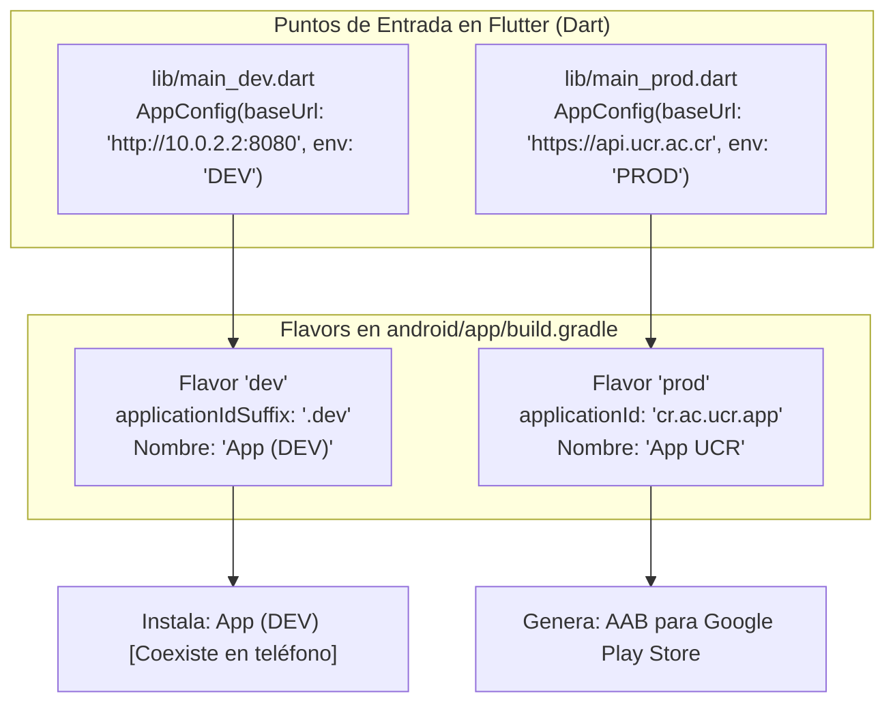

**UNIVERSIDAD DE COSTA RICA**  
**SEDE DEL ATLÁNTICO - RECINTO PARAÍSO**  
**CARRERA DE INFORMÁTICA EMPRESARIAL**  
**CURSO:** IF0009 - Desarrollo de Software IV  
**PROFESOR:** Mag. Jonathan Granados C.  
**SEMESTRE:** II-2026  

---

# Tema 7.2.4: Arquitectura de Entornos Móviles: Configuración Esencial de Flavors en Flutter (Dev y Prod)

> [!NOTE]
> Este documento corresponde a la lectura técnica del **Subtema 7.2.4**. En esta lección usted aprenderá la implementación esencial de múltiples entornos de compilación (**Flavors**) en **Flutter 3**. Analizaremos el esquema dual mínimo (**Desarrollo vs. Producción**), configurando sufijos de paquete en Gradle y puntos de entrada independientes en Dart para evitar la modificación manual de URLs de endpoints.

---

## 1. Resumen Ejecutivo

Un error crítico frecuente en el desarrollo móvil consiste en alternar manualmente entre la URL del servidor local (`http://10.0.2.2:8080`) y la URL del servidor de producción antes de compilar un paquete para la tienda. Esta práctica manual inevitablemente conduce a incidentes donde versiones productivas terminan apuntando a bases de datos de pruebas o viceversa. En este módulo, usted aprenderá a estructurar una arquitectura de variantes (**Flavors**) que permite compilar de forma automatizada e instalar en paralelo la versión de desarrollo y la versión de producción en el mismo dispositivo físico.

---

## 2. Concepto Principal (El "Qué"): Arquitectura de Variantes y Puntos de Entrada



### 2.1 Coexistencia en el Mismo Dispositivo
Al asignar un sufijo de identificador de aplicación (`applicationIdSuffix: ".dev"`), el sistema operativo Android reconoce la versión de desarrollo como una aplicación **completamente independiente** de la versión de producción:
* El desarrollador puede tener instalada la versión de Google Play y la versión local en depuración simultáneamente en el mismo smartphone sin que una sobrescriba los datos de la otra.

---

## 3. Analogía Didáctica (La Intuición)

Piense en los Flavors como los canales de prueba de un automóvil en una fábrica:
* **Entorno de Pruebas (Flavor Dev):** El automóvil lleva una carrocería con pintura de camuflaje de prueba y una calcomanía reflectiva visible que dice "VEHÍCULO EXPERIMENTAL" (nombre de la app con sufijo DEV e icono distinguible). Se alimenta con combustible sintético de laboratorio (base de datos local / mock).
* **Entorno Oficial (Flavor Prod):** Es el automóvil final con pintura de lujo, acabados definitivos y listo para ser entregado en el concesionario oficial (Google Play Store).
* Los dos vehículos pueden estar estacionados en el mismo garaje (su teléfono) sin confundirse entre sí.

---

## 4. Implementación Técnica (El "Cómo"): Esquema Dual en Flutter 3

### **1.** Configuración en `android/app/build.gradle`

Dentro del bloque `android { ... }`, declare la dimensión y los dos flavors:

```groovy
android {
    ...
    flavorDimensions "default"

    productFlavors {
        dev {
            dimension "default"
            applicationIdSuffix ".dev"
            resValue "string", "app_name", "UCR Móvil (DEV)"
        }
        prod {
            dimension "default"
            resValue "string", "app_name", "UCR Móvil"
        }
    }
}
```

### **2.** Clase de Configuración Centralizada en Dart

Creamos el archivo `lib/config/app_config.dart`:

```dart
class AppConfig {
  final String nombreApp;
  final String apiBaseUrl;
  final bool esDesarrollo;

  static late AppConfig instancia;

  AppConfig({
    required this.nombreApp,
    required this.apiBaseUrl,
    required this.esDesarrollo,
  });
}
```

### **3.** Puntos de Entrada Independientes

* **Punto de Entrada Desarrollo (`lib/main_dev.dart`):**
  ```dart
  import 'package:flutter/material.dart';
  import 'config/app_config.dart';
  import 'main_comun.dart';

  void main() {
    AppConfig.instancia = AppConfig(
      nombreApp: 'UCR Móvil (DEV)',
      apiBaseUrl: 'http://10.0.2.2:8080/api/v1',
      esDesarrollo: true,
    );
    iniciarAplicacion();
  }
  ```

* **Punto de Entrada Producción (`lib/main_prod.dart`):**
  ```dart
  import 'package:flutter/material.dart';
  import 'config/app_config.dart';
  import 'main_comun.dart';

  void main() {
    AppConfig.instancia = AppConfig(
      nombreApp: 'UCR Móvil',
      apiBaseUrl: 'https://api.ucr.ac.cr/api/v1',
      esDesarrollo: false,
    );
    iniciarAplicacion();
  }
  ```

### **4.** Comandos de Ejecución y Compilación

* **Para depurar en desarrollo:**
  ```bash
  flutter run --flavor dev -t lib/main_dev.dart
  ```
* **Para compilar el paquete de producción para Google Play:**
  ```bash
  flutter build appbundle --flavor prod -t lib/main_prod.dart
  ```

---

## 5. Trampas Comunes y Antipatrones

*   **Olvidar la bandera `-t lib/main_*.dart`:** Ejecutar `flutter run --flavor dev` sin especificar `-t`. Flutter buscará por defecto `lib/main.dart` sin inicializar la configuración del flavor.
*   **Dejar servicios de analítica de producción activos en Dev:** Enviar eventos de prueba generados por los desarrolladores a la base de datos de telemetría de producción (*Google Analytics*), distorsionando las métricas de negocio.

---

## 6. Preguntas de Reflexión y Autoevaluación

1. ¿Por qué el uso de `applicationIdSuffix: ".dev"` permite que un ingeniero de pruebas conserve instalada la versión oficial de producción en su teléfono mientras evalúa un nuevo desarrollo?
2. ¿Qué riesgo operacional previene tener dos archivos `main_dev.dart` y `main_prod.dart` separados frente a utilizar una condición `if (kDebugMode)` en un único archivo `main.dart`?

