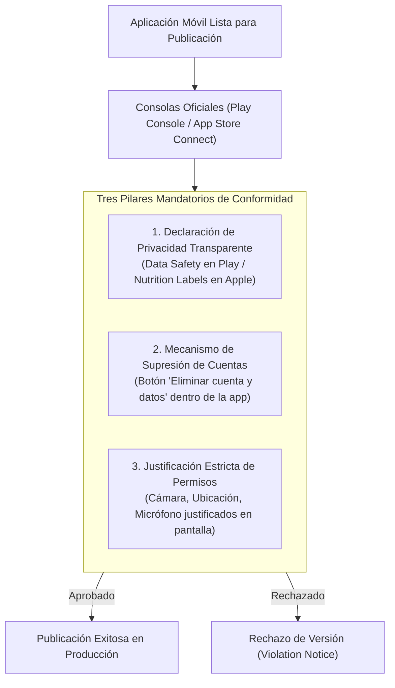

**UNIVERSIDAD DE COSTA RICA**  
**SEDE DEL ATLÁNTICO - RECINTO PARAÍSO**  
**CARRERA DE INFORMÁTICA EMPRESARIAL**  
**CURSO:** IF0009 - Desarrollo de Software IV  
**PROFESOR:** Mag. Jonathan Granados C.  
**SEMESTRE:** II-2026  

---

# Tema 7.2.5: Directrices de Aprobación en Tiendas: Privacidad (Data Safety), Eliminación de Cuentas y Políticas

> [!NOTE]
> Este documento corresponde a la lectura técnica del **Subtema 7.2.5**. En esta lección usted aprenderá los requisitos mandatorios de conformidad regulatoria exigidos por **Google Play Store** y **Apple App Store**. Analizaremos las declaraciones de privacidad (**Data Safety / Privacy Nutrition Labels**), el requisito legal de **Supresión de Cuentas** y las mejores prácticas para evitar el rechazo de aplicaciones durante el proceso de revisión.

---

## 1. Resumen Ejecutivo

Haber compilado un binario firmado libre de errores técnicos no garantiza su publicación; tanto Google como Apple someten cada aplicación a rigurosos procesos de revisión humana y automatizada antes de autorizar su distribución pública. La gran mayoría de los rechazos en tiendas no se deben a fallas de código, sino al incumplimiento de normativas de privacidad, recolección excesiva de datos de usuario sin consentimiento o la ausencia de opciones para eliminar cuentas registradas. En este módulo, usted conocerá los requisitos esenciales para superar la revisión de tiendas a la primera entrega.

---

## 2. Concepto Principal (El "Qué"): Requisitos Esenciales de Conformidad



### 2.1 Declaraciones de Seguridad y Privacidad de Datos
Tanto Google como Apple exigen que el desarrollador complete un cuestionario legal detallado antes de enviar la app:
* **Datos Recopilados:** Identificadores personales (nombre, correo), ubicación precisa o aproximada, fotos, identificadores de dispositivo.
* **Finalidad:** Funcionalidad de la app, prevención de fraude, personalización o analítica.
* **Seguridad en Tránsito:** Declaración jurada de si todos los datos viajan cifrados sobre HTTPS/TLS.
* **Terceros:** Si los datos se comparten con redes publicitarias o servicios de telemetría externos (Firebase, Sentry).

### 2.2 Requisito Mandatorio: Supresión de Cuenta (Account Deletion)
Si una aplicación permite a los usuarios registrarse o crear una cuenta:
* **Debe incluir obligatoriamente:** Una opción visible dentro de la propia aplicación móvil para que el usuario pueda iniciar la eliminación completa de su cuenta y todos sus datos asociados.
* **Enlace Web de Respaldo:** Debe proporcionarse una URL pública donde un usuario que haya desinstalado la app pueda solicitar la eliminación de sus datos personales sin tener que reinstalar la aplicación.

### 2.3 Solicitud de Permisos en Tiempo de Ejecución (Runtime Permissions)
* Está formalmente prohibido solicitar permisos al iniciar la aplicación si no se necesitan de inmediato.
* Los permisos deben solicitarse **en contexto**: cuando el usuario presiona el botón "Tomar fotografía", se muestra el cuadro de diálogo explicando por qué la app requiere acceso a la cámara.

---

## 3. Analogía Didáctica (La Intuición)

* **Etiquetas de Privacidad:** Piense en la tabla de información nutricional impresa al reverso de un paquete de galletas en el supermercado: el fabricante está obligado por ley a declarar cuántos gramos de azúcar, grasas y sodio contiene el alimento. Si el fabricante oculta que el producto contiene maní (un alérgeno peligroso / datos de geolocalización no declarados), las autoridades sanitarias retiran el producto de todos los estantes.
* **Eliminación de Cuenta:** Es el derecho legal del consumidor a cancelar una suscripción en un gimnasio: si el gimnasio le permite inscribirse con un solo clic desde su teléfono, está obligado a permitirle cancelar su membresía con la misma facilidad, sin exigirle enviar cartas físicas notariales.

---

## 4. Implementación Técnica (El "Cómo"): Interfaz de Supresión de Cuenta en Flutter 3

Diseñamos una vista de configuración con el flujo de eliminación de cuenta conforme a las directrices de Apple y Google:

```dart
import 'package:flutter/material.dart';

class PantallaConfiguracionCuenta extends StatelessWidget {
  const PantallaConfiguracionCuenta({super.key});

  void _confirmarEliminacion(BuildContext context) {
    showDialog(
      context: context,
      builder: (ctx) => AlertDialog(
        title: const Text('¿Eliminar cuenta permanentemente?'),
        content: const Text(
          'Esta acción borrará todos sus expedientes y datos personales '
          'asociados de forma irreversible de nuestros servidores.',
        ),
        actions: [
          TextButton(
            onPressed: () => Navigator.pop(ctx),
            child: const Text('Cancelar'),
          ),
          ElevatedButton(
            style: ElevatedButton.styleFrom(backgroundColor: Colors.red),
            onPressed: () {
              Navigator.pop(ctx);
              _ejecutarBorradoEnBackend(context);
            },
            child: const Text('Eliminar definitivamente'),
          ),
        ],
      ),
    );
  }

  Future<void> _ejecutarBorradoEnBackend(BuildContext context) async {
    // 1. Llama al endpoint DELETE /api/v1/usuarios/mi-cuenta en Spring Boot
    // 2. Limpia el almacenamiento seguro local (flutter_secure_storage)
    // 3. Redirige a la pantalla de login
  }

  @override
  Widget build(BuildContext context) {
    return Scaffold(
      appBar: AppBar(title: const Text('Ajustes de Cuenta')),
      body: ListView(
        padding: const EdgeInsets.all(16.0),
        children: [
          const ListTile(
            leading: Icon(Icons.privacy_tip_outlined),
            title: Text('Política de Privacidad'),
            subtitle: Text('Consulte cómo protegemos sus datos'),
          ),
          const Divider(),
          ListTile(
            leading: const Icon(Icons.delete_forever, color: Colors.red),
            title: const Text(
              'Eliminar mi cuenta', 
              style: TextStyle(color: Colors.red, fontWeight: FontWeight.bold),
            ),
            subtitle: const Text('Borrado permanente de su usuario y datos'),
            onTap: () => _confirmarEliminacion(context),
          ),
        ],
      ),
    );
  }
}
```

---

## 5. Trampas Comunes y Antipatrones

*   **Enlace roto a la Política de Privacidad:** Colocar un enlace a una página que devuelve error 404 o que no detalla expresamente el nombre de la aplicación.
*   **Solicitar permisos de ubicación en segundo plano sin justificación:** Pedir `ACCESS_BACKGROUND_LOCATION` cuando la app solo necesita la ubicación mientras está abierta. Google Play rechaza automáticamente el 90% de las solicitudes de ubicación en segundo plano que no demuestren necesidad operativa crítica.
*   **Proveer únicamente un correo para eliminar cuenta:** Indicar *"Para borrar su cuenta envíe un correo a soporte@empresa.com"*. Apple rechaza apps que no provean un mecanismo automatizado o botón directo dentro de la interfaz.

---

## 6. Preguntas de Reflexión y Autoevaluación

1. ¿Por qué las tiendas oficiales sancionan severamente a las aplicaciones que solicitan permisos de hardware que nunca son utilizados en sus pantallas?
2. Si una aplicación móvil utiliza un SDK de terceros (como un servicio de mapas o métricas), ¿debe el desarrollador declarar la recolección de datos que realiza ese SDK en el formulario de *Data Safety* de la tienda?

